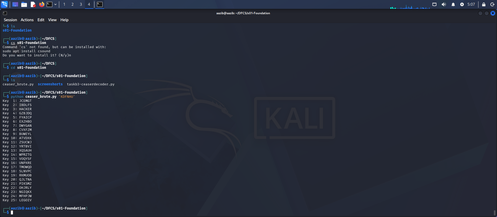

# Task B3: Caesar Cipher Decoderx

## What I built

A Python script that takes a Caesar-shifted string and prints all 25 possible decodings, one per key. Since a Caesar cipher only shifts letters by a fixed amount, trying every shift is enough to find the original message.

## The script (`caesar_brute.py`)

```python
import sys

if len(sys.argv) < 2:
    print("Usage: python3 caesar_brute.py 'SHIFTED TEXT'")
    sys.exit(1)

text = sys.argv[1].upper()

for key in range(1, 26):
    out = ''
    for c in text:
        if c.isalpha():
            out += chr((ord(c) - 65 - key) % 26 + 65)
        else:
            out += c
    print(f'Key {key:2d}: {out}')
```

## Sample run

Command:

```bash
python3 caesar_brute.py 'KDFNHU'
```



**What this proves:** Key 3 produces the readable word `HACKER`, so the original shift was +3. The other 24 lines are meaningless, which makes the correct one easy to spot.

## Why 25 tries is not security

There are only 25 possible keys, and a computer can iterate through all of them in less than a second. Consequently, this does not provide actual security, but rather serves as a demonstration of the concept of a "key."
