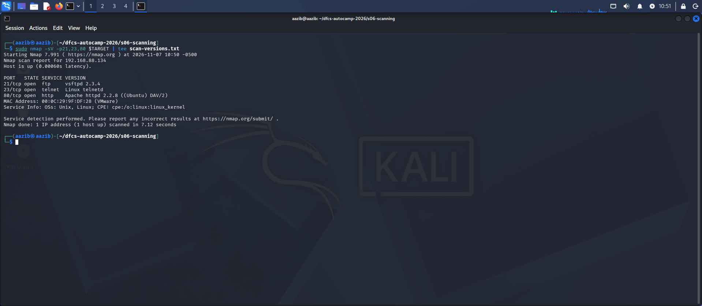
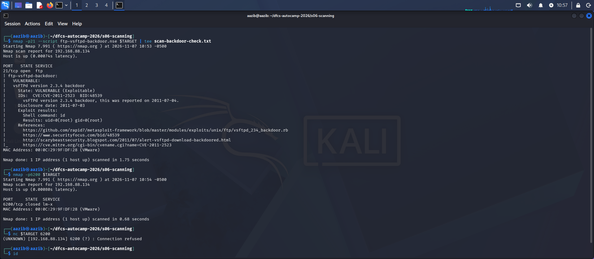
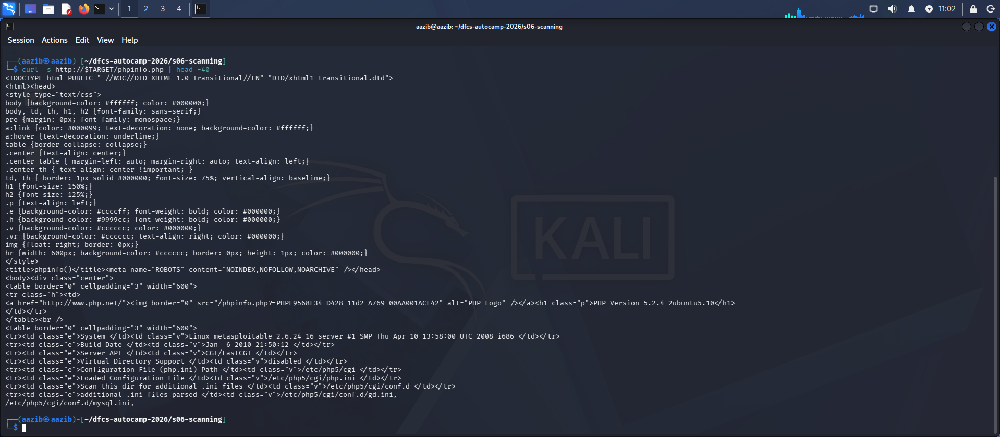
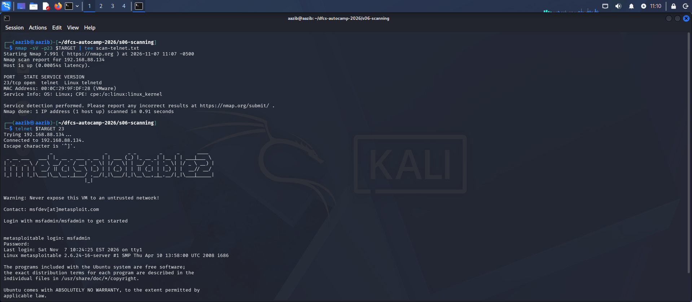

# Task A: Three Findings — Metasploitable 2
**Student:** Aazib Ali

## Finding 1: FTP Backdoor Command Execution in vsftpd 2.3.4

**Severity:** 9.8 Critical — CVSS:3.1/AV:N/AC:L/PR:N/UI:N/S:U/C:H/I:H/A:H

**Affected asset:** 192.168.88.134:21/tcp — vsftpd 2.3.4

**Identifiers:** CVE-2011-2523 | CWE-78 (OS Command Injection) | cpe:/a:vsftpd:vsftpd:2.3.4

**Description:**
The FTP server (port 21) on the target was found running vsftpd 2.3.4. This
version contains a backdoor that was not introduced through a coding error,
but through a compromise of the distribution archive itself: between 30 June
and 3 July 2011, the official download server was serving a tampered copy of
the software (a supply-chain compromise). When a specific character sequence
(":)") is supplied as the FTP username, the backdoor triggers and opens a
command shell on port 6200/tcp, with no authentication required.

**Evidence:**
Version detection confirmed the target is running vsftpd 2.3.4 on port 21:

The nmap `ftp-vsftpd-backdoor.nse` script triggered the backdoor and confirmed
the target is VULNERABLE, executing the `id` command and receiving
`uid=0(root) gid=0(root)` in response:

Commands used:

nmap -sV -p21,23,80 192.168.88.134
nmap -p21 --script ftp-vsftpd-backdoor.nse 192.168.88.134

Scan performed: 7 November 2026, 10:53 (Kali VM local time)

**Proof of concept:**
1. The nmap `ftp-vsftpd-backdoor.nse` script connects to FTP (port 21) and
   supplies a username containing the triggering character sequence.
2. Once triggered, the backdoor opens a command shell and allows a single
   command to be executed; in this case the script itself executed `id`.
3. The response `uid=0(root) gid=0(root)` confirms the shell runs with
   **root-level privileges**, with no credentials required.
   (Note: the backdoor shell remains open for only one connection, so a
   second manual connection attempt to port 6200 is refused — this is
   expected behaviour, not a failed exploit.)

**Impact:**
Any party able to reach port 21 over the network can obtain **unauthenticated
remote code execution as root** on the target. The same host also runs
MySQL (3306) and PostgreSQL (5432), so a compromise of this service would
also expose any data held in those database services.

**Remediation:**
Upgrade vsftpd to a current, patched release, and always verify the vendor's
official package signatures before installing software, to ensure a
compromised archive is never deployed.

**References:**
- https://security-tracker.debian.org/tracker/CVE-2011-2523
- https://cve.mitre.org/cgi-bin/cvename.cgi?name=CVE-2011-2523
- https://github.com/rapid7/metasploit-framework/blob/master/modules/exploits/unix/ftp/vsftpd_234_backdoor.rb

## Finding 2: Exposed phpinfo.php — Information Disclosure

**Severity:** 5.3 Medium (approximate; used for reconnaissance rather than direct exploitation) — CVSS:3.1/AV:N/AC:L/PR:N/UI:N/S:U/C:L/I:N/A:N

**Affected asset:** 192.168.88.134:80/tcp — Apache httpd, PHP 5.2.4-2ubuntu5.10

**Identifiers:** CWE-200 (Exposure of Sensitive Information to an Unauthorized Actor)

**Description:**
The file `/phpinfo.php` is publicly accessible on the target with no
authentication required. This file is the output of PHP's built-in
`phpinfo()` function, which prints the server's complete internal
configuration — PHP version, operating system version, configuration file
paths, loaded modules and environment variables. This kind of file should
only exist during development or debugging and should never be left on a
production server.

**Evidence:**
The `http-enum.nse` script automatically detected this file:

Opening the file via browser/curl confirmed that PHP Version 5.2.4-2ubuntu5.10
and internal system information are publicly visible:

Commands used:

nmap -p80 --script http-enum.nse 192.168.88.134
curl -s http://192.168.88.134/phpinfo.php | head -40

Scan performed: 7 November 2026 (Kali VM local time)

**Proof of concept:**
1. Send a browser or curl request to `http://192.168.88.134/phpinfo.php`.
2. The server returns the full configuration page with no login or
   credential required.
3. The page reveals the PHP version, OS version, and internal file paths.

**Impact:**
An attacker can learn the target's exact software versions and internal
server layout without performing any exploitation. This information lets an
attacker select a precisely targeted exploit (for example, known
vulnerabilities in PHP 5.2.4) and significantly reduces the reconnaissance
effort required.

**Remediation:**
Remove `phpinfo.php` from the production server, or restrict access to it
to trusted internal/admin IPs only. Debugging files should never be left
in a live/production environment.

**References:**
- https://www.php.net/manual/en/function.phpinfo.php
- https://cwe.mitre.org/data/definitions/200.html

## Finding 3: Telnet — Cleartext Authentication Protocol

**Severity:** 7.5 High (approximate; no CVE, a design-level weakness) — CVSS:3.1/AV:N/AC:L/PR:N/UI:N/S:U/C:H/I:N/A:N

**Affected asset:** 192.168.88.134:23/tcp — Linux telnetd

**Identifiers:** CWE-319 (Cleartext Transmission of Sensitive Information)

**Description:**
The target is running a Telnet service on port 23. Telnet is a legacy
protocol that transmits all data — including usernames and passwords — in
**plain text, with no encryption**. This is not a CVE, since it is not a
coding bug but a **design-level weakness**: Telnet was built before
encryption was a standard requirement for remote access protocols.

**Evidence:**
Version detection confirmed the Telnet service is running (Linux telnetd):

Connecting via Telnet confirmed the service accepts the documented default
credentials (`msfadmin`/`msfadmin`); the system itself displays the warning
*"Never expose this VM to an untrusted network!"*:

Commands used:

nmap -sV -p23 192.168.88.134
telnet 192.168.88.134 23

Scan performed: 7 November 2026, 11:07 (Kali VM local time)

**Proof of concept:**
1. Connected to the target with `telnet 192.168.88.134 23`.
2. Entered username and password at the plain-text prompts; no encryption
   was involved at any point.
3. If network traffic is captured during this exchange (e.g. with
   `tcpdump`), the username and password appear directly in the captured
   packets as readable text.

**Impact:**
Any attacker positioned on the same network segment (for example, on a
shared office network or able to perform packet sniffing) can capture a
Telnet session and read the username and password directly. These stolen
credentials can then be reused to log in as the legitimate user.

**Remediation:**
Disable the Telnet service and use **SSH** instead, which encrypts all
traffic. If Telnet must be kept for a legacy reason, restrict it strictly
to a trusted internal network and never allow it outside a VPN.

**References:**
- https://cwe.mitre.org/data/definitions/319.html
- https://nmap.org/book/man-port-scanning-basics.html

